# sar10_adc: 10-bit 25 MS/s asynchronous SAR ADC in SkyWater sky130A

A 10-bit, 25 MS/s, fully differential asynchronous SAR ADC designed with open-source tools
(xschem, ngspice, Magic, KLayout, Netgen, OpenROAD) on the sky130A 130 nm process at 1.8 V.
Every number below is **post-layout** (capacitance-extracted layout netlist), simulated at the transistor level.


## Key specifications (version v11a)

| Parameter | Value |
|---|---|
| Process | SkyWater sky130A, 1.8 V core devices |
| Resolution | 10 bit |
| Sample rate | 25 MS/s (typical and slow corner) |
| Input | Fully differential, 1.4 V peak differential (−0.7 dBFS) |
| Architecture | Asynchronous SAR, split-capacitor CDAC, top-plate bootstrapped sampling, StrongARM comparator |
| ENOB, typical corner | 9.58 bit (SNDR 59.4 dB) |
| SFDR, typical corner | 68.0 dB |
| ENOB, slow corner (ss, 125 °C, 1.62 V) | 9.13 bit (SNDR 56.7 dB) |
| Power at 25 MS/s, typical | 433 µW (VDD 349 µW + reference 84 µW) |
| Walden FoM, typical | 22.6 fJ/conversion-step |
| Conversion time, typical | 15.39 ns worst case (30 ns available) |
| Conversion time, slow corner | 32.83 ns to EOC; output bits valid at 33.55 ns (34 ns available) |
| Core area | 148.5 µm × 159.8 µm = 0.0237 mm² |
| Physical verification | Magic DRC 0, KLayout DRC 0, Netgen LVS match |

## Dynamic performance (post-layout, 25 MS/s, fin = 5.08 MHz, 64-point coherent FFT)


| Corner | Sampling time | SNDR | ENOB | SFDR | THD | Worst conversion | Power |
|---|---|---|---|---|---|---|---|
| tt / 27 °C / 1.8 V | 10 ns | 59.4 dB | 9.58 | 68.0 dB | — | 15.39 ns | 433 µW |
| ss / 125 °C / 1.62 V | 6 ns | 56.7 dB | 9.13 | 60.6 dB | −60.4 dB | 32.83 ns | 360 µW |
| ss / 125 °C / 1.62 V, 22 MS/s | 9.1 ns | 56.6 dB | 9.10 | 60.6 dB | −60.4 dB | 32.86 ns | 316 µW |

A 64-point FFT tests only 64 code positions: differences under about 0.2 bit between runs are within its spread.

## Corners (post-layout, 25 MS/s, fin = 5.08 MHz, 6 ns sampling, 34 ns conversion window)

| Corner | SNDR | ENOB | SFDR | THD | Worst conversion | Output bits valid | Power |
|---|---|---|---|---|---|---|---|
| tt 27°C 1.8V | 59.4 dB | 9.58 | 68.0 dB | -71.0 dB | 15.39 ns | 15.76 ns | 433 µW |
| tt -40°C | 58.9 dB | 9.48 | 66.5 dB | -69.1 dB | 16.66 ns | 16.99 ns | 425 µW |
| tt 125°C | 59.2 dB | 9.55 | 68.3 dB | -72.4 dB | 15.22 ns | 15.56 ns | 453 µW |
| fs 27°C | 57.2 dB | 9.21 | 62.8 dB | -61.8 dB | 19.53 ns | 19.88 ns | 426 µW |
| sf 27°C | 50.3 dB | 8.06 | 58.7 dB | -58.0 dB | 15.10 ns | 15.53 ns | 437 µW |
| ff -40°C 1.98V | 52.2 dB | 8.38 | 59.5 dB | -62.9 dB | 8.48 ns | 8.69 ns | 517 µW |
| ss 125°C 1.62V | 56.7 dB | 9.13 | 60.6 dB | -60.4 dB | 32.83 ns | 33.55 ns | 360 µW |

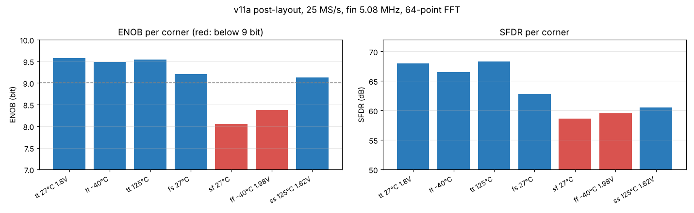

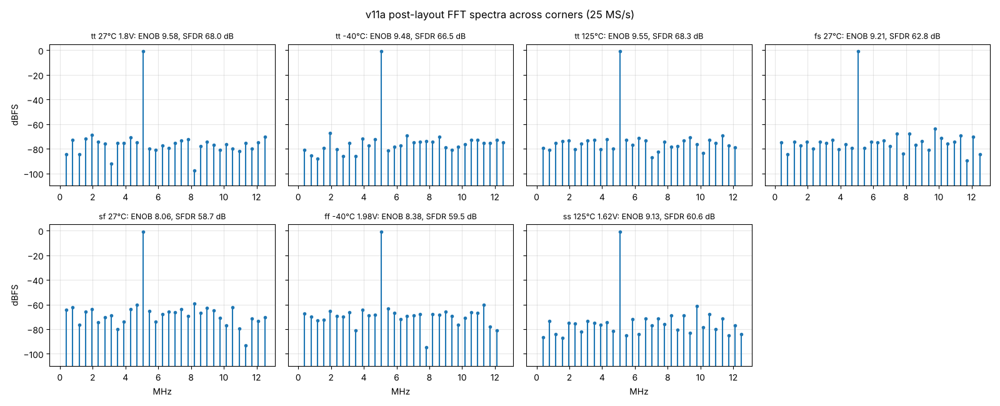

Typical, temperature and slow corners keep at least 9.1 bit. Two corners lose more than one bit through
harmonic distortion (SFDR below 60 dB): **sf** (slow NMOS, fast PMOS) at 8.06 bit and **ff at −40 °C, 1.98 V**
at 8.38 bit. Both have fast PMOS; the cause (sampling switch or CDAC switches) is not yet isolated.

### PVT sweep (19 corners, 8 DC inputs each)

Each corner converts 8 DC inputs across the range; "worst nonlinearity" is the deviation from a straight-line fit
with quantisation removed.

| Corner | Worst nonlinearity | rms | Worst conversion | Output bits valid | Power | Unfinished |
|---|---|---|---|---|---|---|
| tt -40 °C 1.8 V | 0.165 LSB | 0.086 LSB | 16.33 ns | 16.71 ns | 425 µW | 0 |
| tt 27 °C 1.62 V | 0.207 LSB | 0.099 LSB | 23.17 ns | 23.31 ns | 346 µW | 0 |
| tt 27 °C 1.8 V | 0.214 LSB | 0.104 LSB | 15.39 ns | 15.76 ns | 433 µW | 0 |
| tt 27 °C 1.98 V | 0.220 LSB | 0.107 LSB | 11.96 ns | 12.26 ns | 532 µW | 0 |
| tt 125 °C 1.8 V | 0.215 LSB | 0.104 LSB | 14.98 ns | 15.34 ns | 453 µW | 0 |
| ss -40 °C 1.8 V | 0.199 LSB | 0.095 LSB | 28.12 ns | 28.70 ns | 430 µW | 0 |
| ss 27 °C 1.8 V | 0.207 LSB | 0.099 LSB | 24.86 ns | 25.43 ns | 438 µW | 0 |
| ss 125 °C 1.62 V | 0.207 LSB | 0.108 LSB | 32.47 ns | 33.14 ns | 360 µW | 0 |
| ss 125 °C 1.8 V | 0.176 LSB | 0.093 LSB | 23.21 ns | 23.73 ns | 451 µW | 0 |
| ff -40 °C 1.8 V | 0.173 LSB | 0.091 LSB | 10.63 ns | 10.90 ns | 421 µW | 0 |
| ff -40 °C 1.98 V | 0.232 LSB | 0.119 LSB | 8.41 ns | 8.60 ns | 518 µW | 0 |
| ff 27 °C 1.8 V | 0.173 LSB | 0.092 LSB | 10.43 ns | 10.69 ns | 433 µW | 0 |
| ff 125 °C 1.8 V | 0.213 LSB | 0.103 LSB | 10.52 ns | 10.77 ns | 477 µW | 0 |
| fs -40 °C 1.8 V | 0.223 LSB | 0.105 LSB | 22.40 ns | 22.75 ns | 415 µW | 0 |
| fs 27 °C 1.8 V | 0.177 LSB | 0.094 LSB | 19.17 ns | 19.50 ns | 426 µW | 0 |
| fs 125 °C 1.8 V | **151.121 (failed)** LSB | 71.022 LSB | 18.12 ns | 18.47 ns | 535 µW | **2 of 8** |
| sf -40 °C 1.8 V | 0.235 LSB | 0.110 LSB | 15.42 ns | 15.86 ns | 430 µW | 0 |
| sf 27 °C 1.8 V | 0.238 LSB | 0.114 LSB | 14.92 ns | 15.34 ns | 439 µW | 0 |
| sf 125 °C 1.8 V | 0.199 LSB | 0.108 LSB | 14.95 ns | 15.32 ns | 457 µW | 0 |

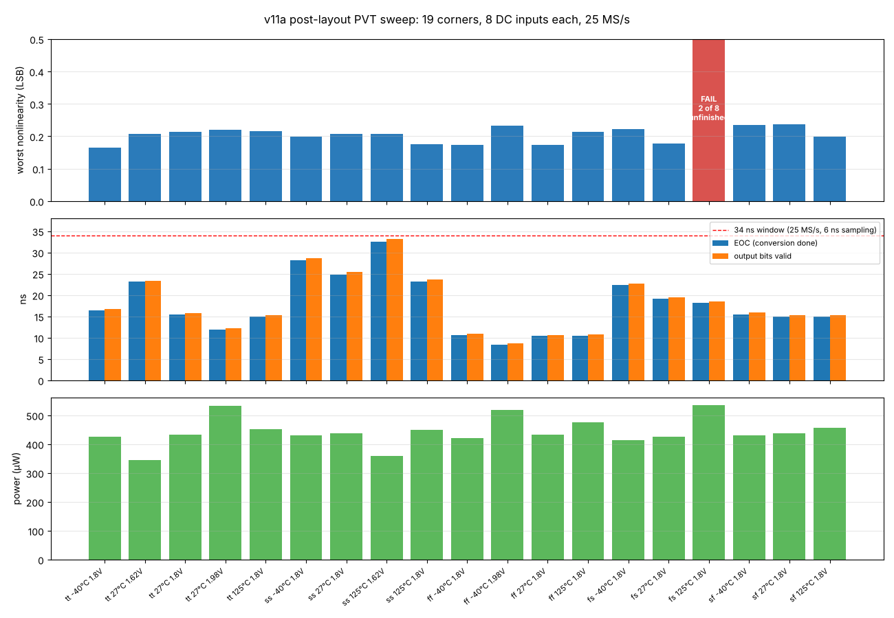

All corners finish within the 34 ns window with at most 0.24 LSB nonlinearity, **except fs (fast NMOS, slow PMOS) at
125 °C, 1.8 V**: 2 of 8 conversions never finished (no end-of-conversion), which corrupts the codes. This is a
functional failure of the self-timed loop at that corner and is under investigation.

## Linearity

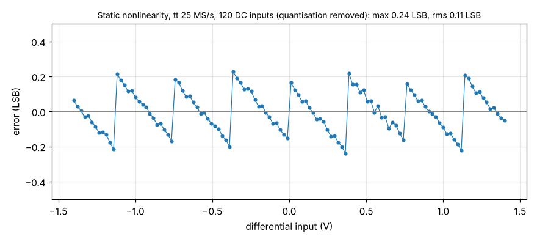

Typical corner, 120 DC inputs over ±1.4 V: max 0.24 LSB, rms 0.12 LSB, dominated by a 3rd-order term (0.07 LSB).

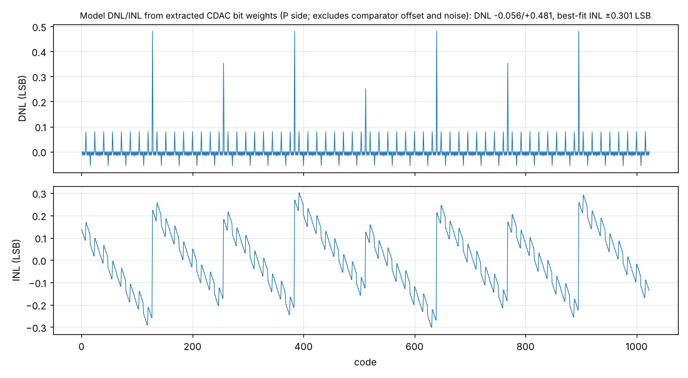

INL/DNL computed from the extracted CDAC bit weights alone (P side; comparator offset and noise not included):
DNL −0.06/+0.48 LSB, best-fit INL ±0.30 LSB. The largest DNL step is at the MSB transition.

## Architecture

| Block | Implementation |
|---|---|
| Sampling | Bootstrapped NMOS switch per side, MIM boost capacitor, top-plate sampling |
| CDAC | Split-capacitor array (each bit split into halves resting at VREFP and VREFN: constant common mode, no Vcm reference). Custom 0.8 fF M1/M2 finger unit capacitor, common-centroid columns, dummy ring, guard rings |
| Comparator | StrongARM latch, mirror-symmetric layout with one shared wiring channel for the NMOS and PMOS rows |
| Timing | Self-timed loop: VALID = NAND(OUTP, OUTN), one inverter pair of DAC settling delay, CLKC = NAND3(RUN, delayed VALIDB, VALIDB) |
| SAR logic | 10 slices of sky130_fd_sc_hd cells: AOI/NOR latch per side, token ripple, CDAC pre-drivers next to each latch, output flip-flops clocked by EOC |
| EOC | Driven from the last bit's decision (buf_4); slice reset released directly from the sampling clock |

Schematics (exported from xschem as SVG; sources in `xschem/`):

| Top level | Comparator | Bit slice |
|---|---|---|
| 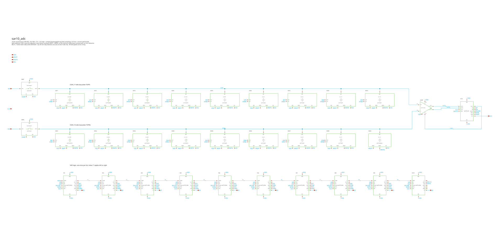 | 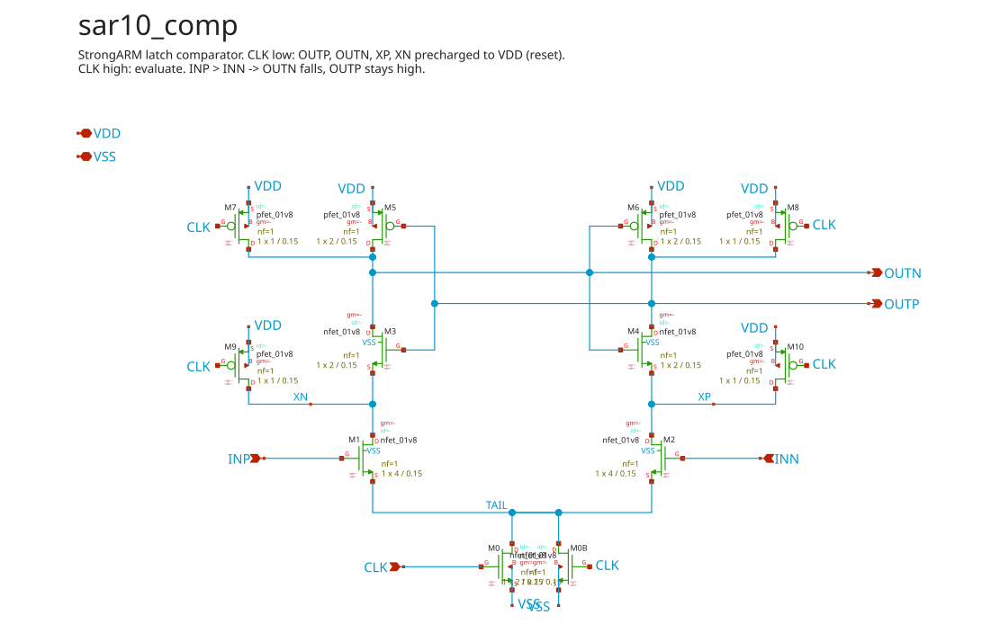 | 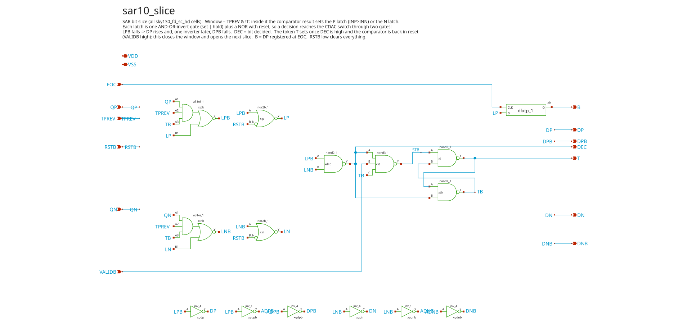 |

| Timing control | Bootstrapped switch | CDAC bit cell |
|---|---|---|
| 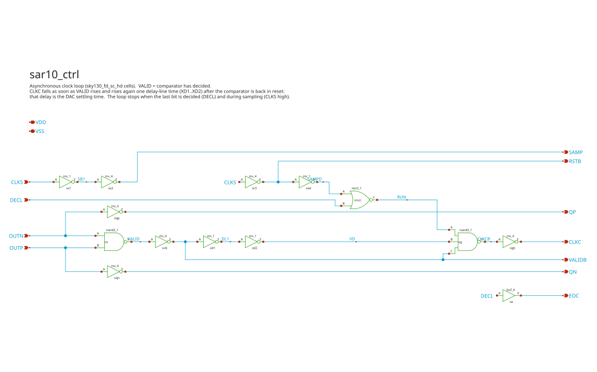 | 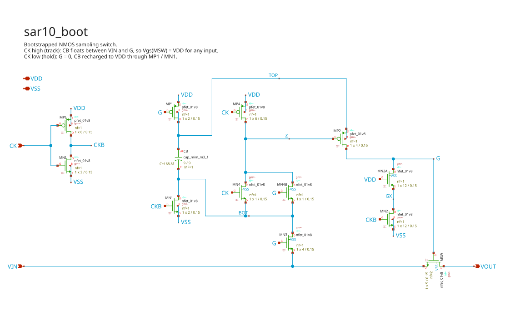 | 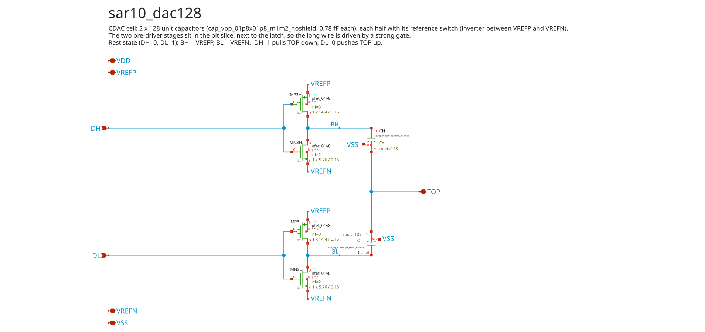 |

| Testbench |
|---|
| 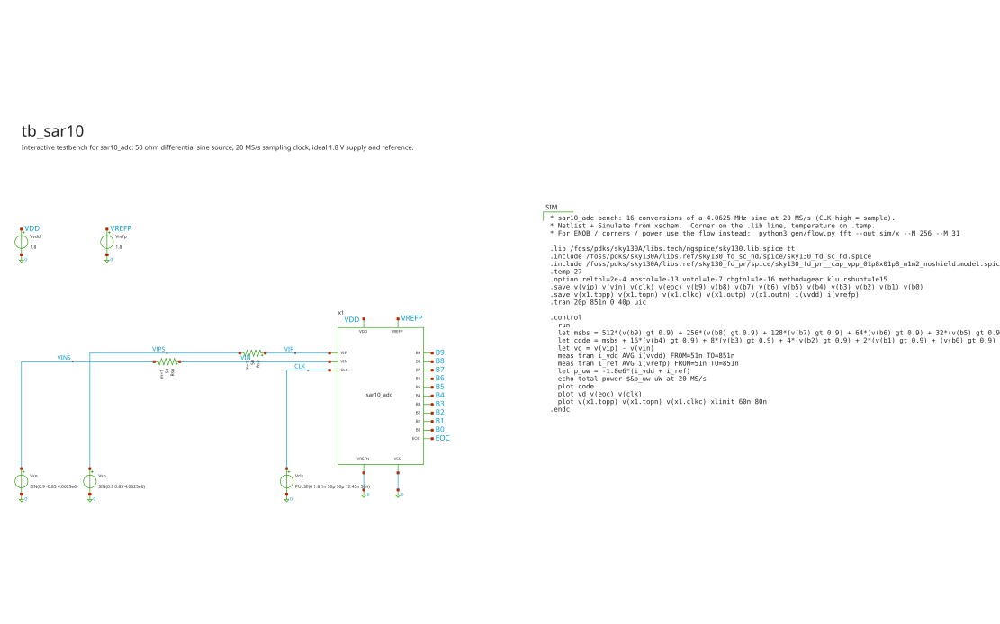 |

## Design history (post-layout, typical corner, 25 MS/s)

| Version | Change | ENOB | Worst conversion | Power |
|---|---|---|---|---|
| v2e | first clean layout baseline | 9.61 | 18.12 ns | 440 µW |
| v9a | pre-drivers moved into the slices, AOI latch, comparator spacing | 9.52 | 16.69 ns | 419 µW |
| v10d | single-channel mirrored comparator, spread output wires | 9.55 | 16.51 ns | 426 µW |
| v10e | MSB drivers on the inner edge, latch clusters, balanced comparator outputs | 9.54 | 16.54 ns | 426 µW |
| **v11a** | reset and EOC control-path waits removed, stronger VALIDB buffer | **9.58** | **15.39 ns** | **433 µW** |

v11a is the first version whose slow-corner conversion fits a 25 MS/s period.

## Limitations

- Extraction is capacitance only: wire and via resistance (reference IR drop, RC settling) is not modelled.
- Ideal VREFP/VREFN supplies and an ideal 50 Ω differential source: no reference buffer, input driver or IO pads.
- No noise or Monte Carlo mismatch simulation yet.
- sf and ff (−40 °C, 1.98 V) corners lose more than 1 bit to distortion; fs at 125 °C, 1.8 V fails (unfinished conversions). See Corners.
- Results are from a 64-point FFT (see note above).

## Repository layout

| Path | Contents |
|---|---|
| `gen/design.py` | Single source of the design: every cell's devices, sizes and schematic drawing |
| `gen/netlist.py`, `gen/draw.py` | Emit the reference SPICE netlist and the xschem schematics/symbols |
| `gen/tb.py`, `gen/flow.py` | ngspice testbenches: FFT, DC, static linearity, PVT corners |
| `gen/run.py`, `spec.json` | One-command experiment ladder: build, DRC/LVS, quick test, FFT, scored against `spec.json` |
| `layout/gen/` | Scripted layout: floorplan and router (`top.py`), device rows (`lay.py`), logic macro via OpenROAD (`dig.py`), DRC/LVS/extraction scripts |
| `layout/gds/sar10_adc.gds` | Final layout |
| `netlist/` | Reference netlist and extracted post-layout netlist |
| `xschem/` | Schematics and symbols |
| `results/` | Raw data: FFT samples, extracted net capacitances, CDAC bit weights, corner results |

## Reproducing

Requires the IIC-OSIC-TOOLS container (or equivalent) with the sky130A PDK, ngspice, Magic, KLayout, Netgen and OpenROAD.

```sh
python3 gen/draw.py xschem            # schematics
bash gen/mknet.sh                     # netlist, compare with the reference netlist
cd layout/gen && python3 top.py       # layout script
cd ../work && bash ../gen/mkdig.sh && bash ../gen/drc.sh sar10_adc.tcl sar10_adc && bash ../gen/lvs.sh && bash ../gen/pex.sh
python3 gen/flow.py fft --out sim/fft --N 64 --M 13 --fs 25e6 --amp 1.4 --acc hi --dut layout/work/sar10_adc_pex.spice
```

Scripts expect the design at `/foss/designs/Analog/SAR_ADC10`; adjust the paths in `gen/run.py` and `layout/gen/*.py` otherwise.

## License

Copyright 2026 Synertax. Licensed under the [Apache License 2.0](LICENSE), the same license as the SkyWater sky130 PDK.
