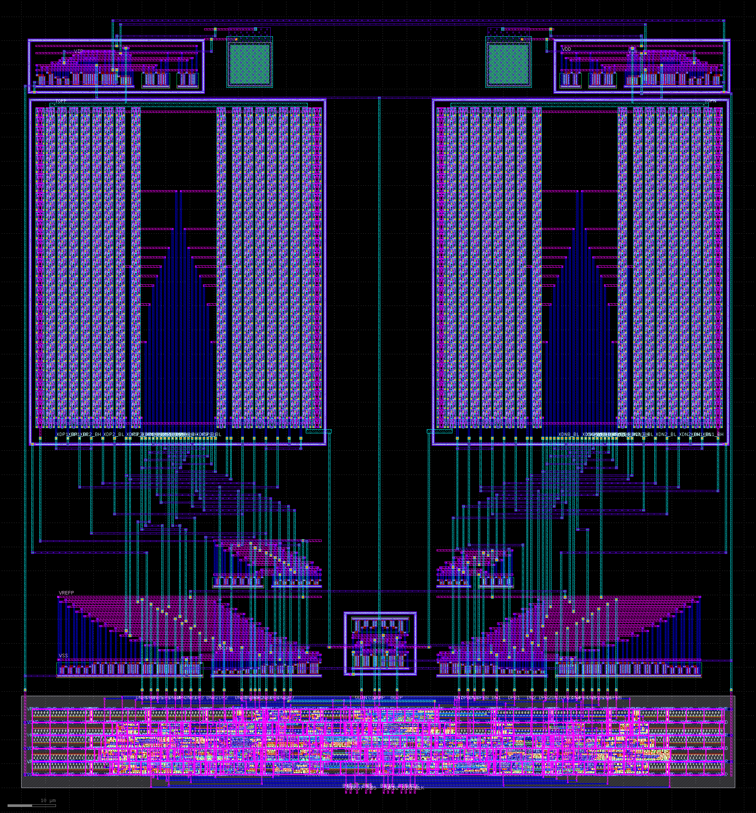
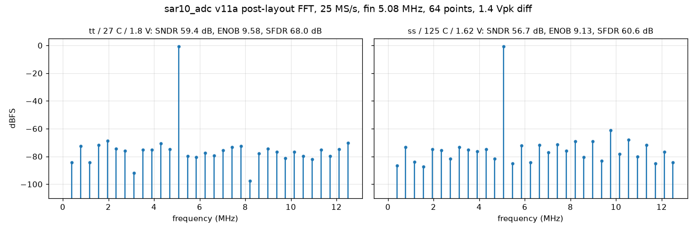
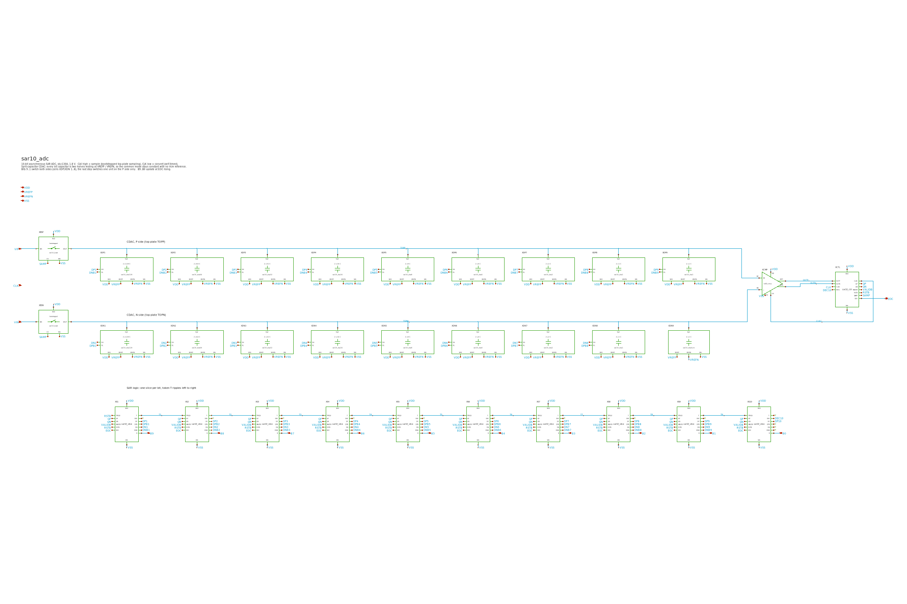
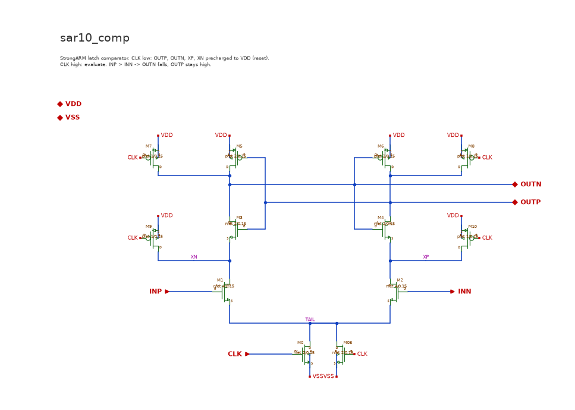
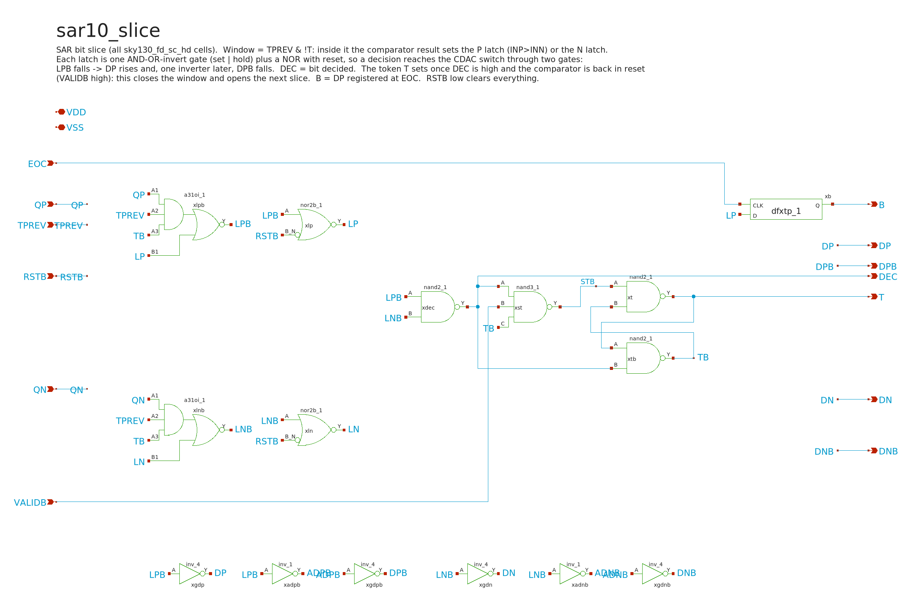
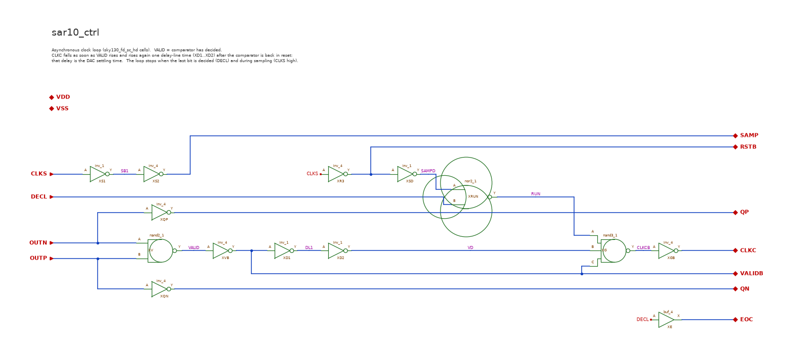
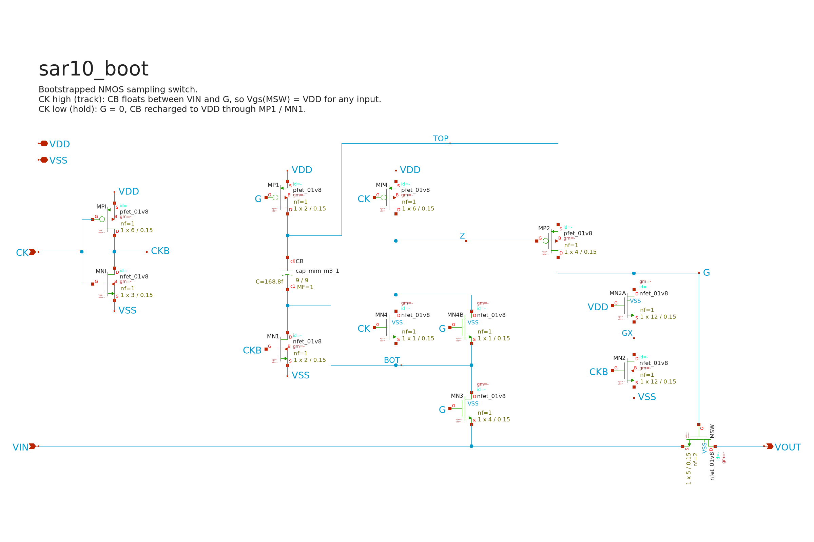
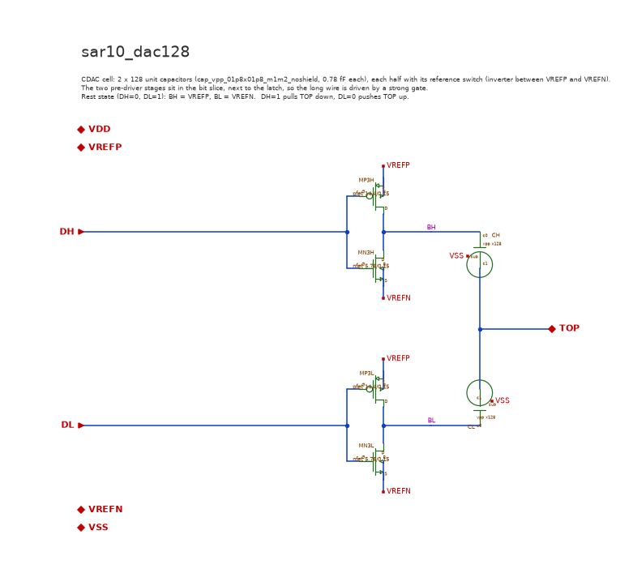

#:10-bit 25 MS/s asynchronous SAR ADC in SkyWater sky130A

A 10-bit, 25 MS/s, fully differential asynchronous SAR ADC designed with open-source tools
(xschem, ngspice, Magic, KLayout, Netgen, OpenROAD) on the sky130A 130 nm process at 1.8 V.
Every number below is **post-layout** (capacitance-extracted layout netlist), simulated at the transistor level.



## Key specifications (version v11a)

| Parameter | Value |
|---|---|
| Process | SkyWater sky130A, 1.8 V core devices |
| Resolution | 10 bit |
| Sample rate | 25 MS/s (typical and slow corner) |
| Input | Fully differential, 1.4 V peak differential (−0.7 dBFS) |
| Architecture | Asynchronous SAR, split-capacitor CDAC, top-plate bootstrapped sampling, StrongARM comparator |
| ENOB, typical corner | 9.58 bit (SNDR 59.4 dB) |
| SFDR, typical corner | 68.0 dB |
| ENOB, slow corner (ss, 125 °C, 1.62 V) | 9.13 bit (SNDR 56.7 dB) |
| Power at 25 MS/s, typical | 433 µW (VDD 349 µW + reference 84 µW) |
| Walden FoM, typical | 22.6 fJ/conversion-step |
| Conversion time, typical | 15.39 ns worst case (30 ns available) |
| Conversion time, slow corner | 32.83 ns to EOC; output bits valid at 33.55 ns (34 ns available) |
| Core area | 148.5 µm × 159.8 µm = 0.0237 mm² |
| Physical verification | Magic DRC 0, KLayout DRC 0, Netgen LVS match |

## Dynamic performance (post-layout, 25 MS/s, fin = 5.08 MHz, 64-point coherent FFT)



| Corner | Sampling time | SNDR | ENOB | SFDR | THD | Worst conversion | Power |
|---|---|---|---|---|---|---|---|
| tt / 27 °C / 1.8 V | 10 ns | 59.4 dB | 9.58 | 68.0 dB | — | 15.39 ns | 433 µW |
| ss / 125 °C / 1.62 V | 6 ns | 56.7 dB | 9.13 | 60.6 dB | −60.4 dB | 32.83 ns | 360 µW |
| ss / 125 °C / 1.62 V, 22 MS/s | 9.1 ns | 56.6 dB | 9.10 | 60.6 dB | −60.4 dB | 32.86 ns | 316 µW |

A 64-point FFT tests only 64 code positions: differences under about 0.2 bit between runs are within its spread.

## Architecture

| Block | Implementation |
|---|---|
| Sampling | Bootstrapped NMOS switch per side, MIM boost capacitor, top-plate sampling |
| CDAC | Split-capacitor array (each bit split into halves resting at VREFP and VREFN: constant common mode, no Vcm reference). Custom 0.8 fF M1/M2 finger unit capacitor, common-centroid columns, dummy ring, guard rings |
| Comparator | StrongARM latch, mirror-symmetric layout with one shared wiring channel for the NMOS and PMOS rows |
| Timing | Self-timed loop: VALID = NAND(OUTP, OUTN), one inverter pair of DAC settling delay, CLKC = NAND3(RUN, delayed VALIDB, VALIDB) |
| SAR logic | 10 slices of sky130_fd_sc_hd cells: AOI/NOR latch per side, token ripple, CDAC pre-drivers next to each latch, output flip-flops clocked by EOC |
| EOC | Driven from the last bit's decision (buf_4); slice reset released directly from the sampling clock |

Schematics (generated, also as xschem `.sch` files in `xschem/`):

| Top level | Comparator | Bit slice |
|---|---|---|
|  |  |  |

| Timing control | Bootstrapped switch | CDAC bit cell |
|---|---|---|
|  |  |  |

## Design history (post-layout, typical corner, 25 MS/s)

| Version | Change | ENOB | Worst conversion | Power |
|---|---|---|---|---|
| v2e | first clean layout baseline | 9.61 | 18.12 ns | 440 µW |
| v9a | pre-drivers moved into the slices, AOI latch, comparator spacing | 9.52 | 16.69 ns | 419 µW |
| v10d | single-channel mirrored comparator, spread output wires | 9.55 | 16.51 ns | 426 µW |
| v10e | MSB drivers on the inner edge, latch clusters, balanced comparator outputs | 9.54 | 16.54 ns | 426 µW |
| **v11a** | reset and EOC control-path waits removed, stronger VALIDB buffer | **9.58** | **15.39 ns** | **433 µW** |

v11a is the first version whose slow-corner conversion fits a 25 MS/s period.

## Limitations

- Extraction is capacitance only: wire and via resistance (reference IR drop, RC settling) is not modelled.
- Ideal VREFP/VREFN supplies and an ideal 50 Ω differential source: no reference buffer, input driver or IO pads.
- No noise or Monte Carlo mismatch simulation yet; fast-corner and temperature-sweep results are being added.
- Results are from a 64-point FFT (see note above).

## Repository layout

| Path | Contents |
|---|---|
| `gen/design.py` | Single source of the design: every cell's devices, sizes and schematic drawing |
| `gen/netlist.py`, `gen/draw.py` | Emit the reference SPICE netlist and the xschem schematics/symbols |
| `gen/tb.py`, `gen/flow.py` | ngspice testbenches: FFT, DC, static linearity, PVT corners |
| `gen/run.py`, `spec.json` | One-command experiment ladder: build, DRC/LVS, quick test, FFT, scored against `spec.json` |
| `layout/gen/` | Scripted layout: floorplan and router (`top.py`), device rows (`lay.py`), logic macro via OpenROAD (`dig.py`), DRC/LVS/extraction scripts |
| `layout/gds/sar10_adc.gds` | Final layout |
| `netlist/` | Reference netlist and extracted post-layout netlist |
| `xschem/` | Schematics and symbols |
| `results/` | Raw data: FFT samples, extracted net capacitances, CDAC bit weights, corner results |

## Reproducing

Requires the IIC-OSIC-TOOLS container (or equivalent) with the sky130A PDK, ngspice, Magic, KLayout, Netgen and OpenROAD.

```sh
python3 gen/draw.py xschem            # schematics
bash gen/mknet.sh                     # netlist, compare with the reference netlist
cd layout/gen && python3 top.py       # layout script
cd ../work && bash ../gen/mkdig.sh && bash ../gen/drc.sh sar10_adc.tcl sar10_adc && bash ../gen/lvs.sh && bash ../gen/pex.sh
python3 gen/flow.py fft --out sim/fft --N 64 --M 13 --fs 25e6 --amp 1.4 --acc hi --dut layout/work/sar10_adc_pex.spice
```

Scripts expect the design at `/foss/designs/Analog/SAR_ADC10`; adjust the paths in `gen/run.py` and `layout/gen/*.py` otherwise.
